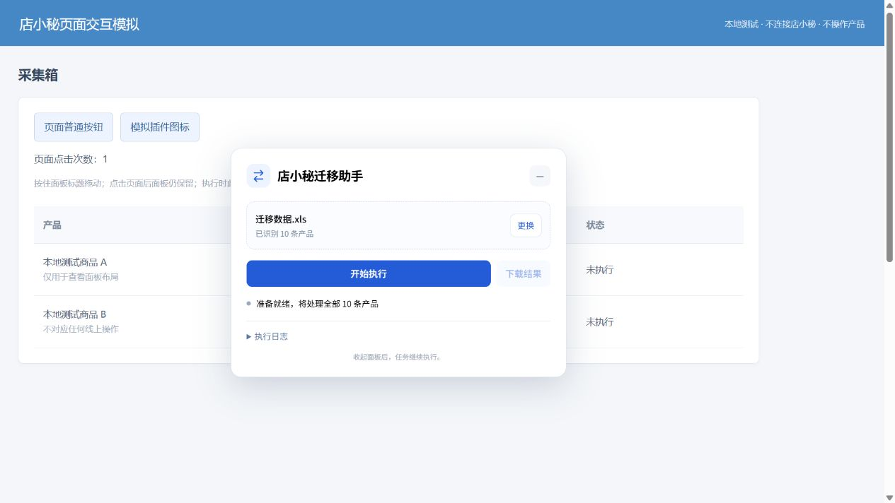

# v0.4 网页内可拖动面板

面板直接显示在店小秘网页内，默认宽度 480px。按住标题栏可拖动位置，点击网页其他位置不会消失。右上角“−”可主动收起，通过网页内的小按钮或工具栏插件图标重新展开。

上传文件、拖动位置和收起状态保存在本机。店小秘页面跳转或刷新后会重新显示面板并恢复位置；窗口大小变化时会限制位置，保持标题栏可见。

仍然只提供上传、开始、停止、下载和日志。整张表执行、固定店铺映射及已确认的填写规则保持不变。开始任务时，后台绑定发出请求的面板所在标签页。

## 实现

- 删除工具栏 `default_popup`；点击插件图标只展开网页内面板。
- 使用 Shadow DOM 隔离界面样式，与店小秘网页的按钮、表格和样式互不干扰。
- `popup.html` 和 `popup.css` 是共享界面源，`tests/build-panel.cjs` 将其生成 `panel-view.js`，随内容脚本本地加载。
- `overlay.js` 处理标题栏指针拖动、边界、记忆位置、收起展开和执行期间的页面输入锁定。
- 没有增加扩展权限，没有使用独立浏览器窗口或浏览器侧边栏。

## 验证

32 项本地代码测试通过。内置浏览器仅打开本地模拟页面，直接运行生产版面板和控制器，验证：

- 面板实际宽度 480px。
- 按住标题栏拖动：位置从 `(780,112)` 移到 `(330,212)`。
- 点击网页普通按钮后，计数增加，面板仍显示。
- 刷新页面后仍恢复到 `(330,212)`。
- 主动收起后，通过模拟插件图标重新展开。
- 模拟开始整表 10 条后，普通网页按钮的可信点击被拦截；停止按钮可用，停止结束后普通按钮重新响应。

此次没有操作真实产品；原有结果仍是 1 条已上线、9 条未执行。本次没有安装扩展运行真实批次，更新后需要重新加载扩展并刷新店小秘页面。

## 更新

解压 v0.4，使用完整的 `extension` 文件夹，在扩展管理页重新加载，然后刷新店小秘页面。面板会在网页内出现；标题栏可拖动，点击其他区域不会收起。
