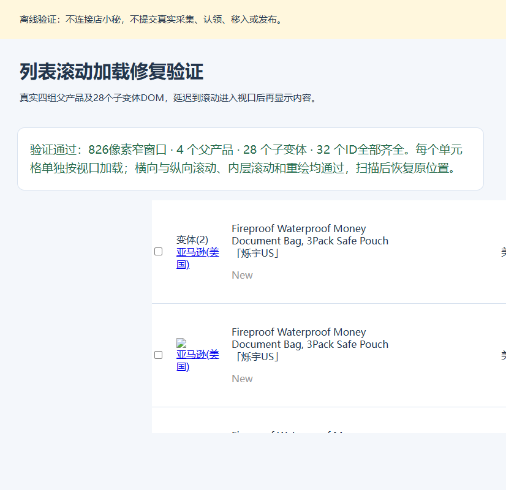

# 列表单元格加载修复

版本：v0.4.46。日期：2026-11-06，北京时间。

## 现场原因

12:00:31认领21条全部成功，12:00:54在读取Amazon采集箱列表时，行184807703406156183加载超时，旧工作流将21条全部记失败并显示批次结束。

现场浏览器视口宽826像素，页面文档宽1350像素。该行的来源、标题、站点和时间已显示，仍有1个占位骨架位于第9列“操作”，单元格在视口右侧。纵向滚动使行位于屏幕内后，操作单元格仍位于x=1189到1289，无法触发按视口加载。横向滚动页面至scrollX=532后，该单元格位于x=657到757，骨架数立即变为0，并显示移入待发布、编辑、发布、更多。

上版对整行调用scrollIntoView并等待整行所有占位消失。整行比窄视口更宽，inline nearest只能显示其中一部分，右侧单元格一直无法进入视口。原离线测试按行触发后一次填充整行，未覆盖真实页面每个单元格独立加载的行为。

现场证据见[evidence/list-cell-timeout-20261106.json](evidence/list-cell-timeout-20261106.json)。本次只进行了只读DOM检查和浏览器滚动，没有重新采集、认领、移入、填写或发布真实商品。

## 修复

1. 每次找到一个尚未加载的可见单元格，按行ID及列ID/列序号重新定位当前节点。滚动目标改为该单元格，横纵方向均居中，触发包括页面和内层滚动容器在内的视口更新。
2. 仅等待当前单元格完成，再定位下一个。等待期间重新定位和滚动，适应节点替换及行高变化；本页全部可见占位加载完成后才读取列表。结束、超时或停止后均恢复原有横纵滚动位置。
3. 列表加载异常携带listIncomplete标记，后台传回工作流，工作流对同页只读读取自动重试3次。兼容旧版“等待超时：加载完整列表行”消息，不重复执行业务提交。
4. 重试后仍不能完整读取时保留待核对保存点，保留已经成功的商品，其他店铺继续；不会把纯读取失败记作所有商品失败，结束日志明确说明仍有列表等待核对。
5. 当前v0.4.45任务在认领成功后已经逐页保存认领ID，并将完整认领记录设为claim_lookup。刷新并继续时先查现有认领映射，恢复后续步骤，不重新采集或认领。移入、发布等结果不明的原有提交保护保持有效。

## 验证

- 全部181项Node测试通过，覆盖只读重试、旧消息兼容、普通业务错误不重试、认领成功后21条只待核对、恢复不重采不重认领、错误标记传递，以及既有提交保护。
- `tests/lazy-list-browser.cjs`改为每个单元格单独用IntersectionObserver触发加载。覆盖1280与826像素视口、文档和内层容器横纵滚动、节点重绘、隐藏行、全部32个父子ID、滚动位置恢复、真实未加载错误与停止。
- 从已发布的v0.4.45 ZIP提取原适配器，在相同窄窗口离线页面复现超时；新版适配器在该页面及其他上述场景通过。通过DXM_BASELINE_ADAPTER可重放旧版对照。
- 店铺准备、认领提交边界、采集重试与21条异常隔离离线浏览器回归继续通过；扩展引用、语法和ZIP完整性检查通过。

更新时用新版覆盖原插件加载目录，再重新加载扩展、刷新页面、点击继续执行。保留当前缓存与表格，以保留本批次认领完成的保存点。
