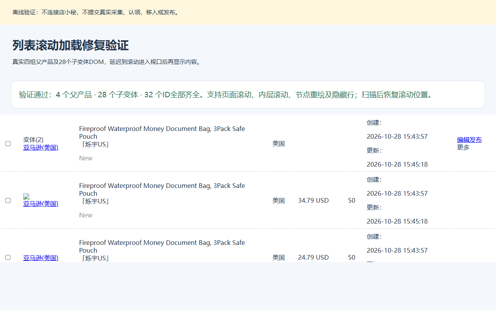

# 首个父产品与单品编辑

版本：v0.4.47。日期：2026-11-06，北京时间。

用户最新更正：“拿第一个就好了，不需要核对什么子变体”。每条来源只取第一个匹配父产品，替代此前全部同源产品组认领、移入和父子ID齐全核对的要求。售卖形式从“多变种”改为“单品”。

## 执行规则

1. 采集完成或跳过后，先按来源链接查找“未认领”，未找到的来源再到“已认领”分页查找；两处均未找到才将该来源标记失败，其他商品继续。两处都有时优先未认领。同来源多条按列表顺序只取第一条，其他历史标题不再阻止处理；首条标题为空仍报错。
2. 用collectorTab记录采集记录所在列表，从相应列表认领到表格指定店铺和站点，恢复保存点时保留该列表。collectorIds只保留一个采集ID；认领后的产品按来源、标题、店铺和站点匹配，productIds只保留第一个父产品ID。旧保存点记录多个ID时也缩减到第一条。重试采集失败时排除两处已找到的来源。
3. Amazon列表父产品是实际编辑入口。插件只选择各来源的首个父产品；勾选父行时店小秘可能自动关联子变体，插件不额外处理或核对子变体。跨页重复父产品保留第一次遇到的记录。
4. 等待平台最终结果弹窗，按所选父产品ID确认移入成功，不再以父子总数判断进度。成功数足够且全部失败明细中没有所选父产品，即可继续；不要求失败子ID属于事先记录的集合，也不核对子变体原因或待发布列表中的子ID。父产品真实失败或最终结果不明确时保留提交保存点。每页确认后保存已移入的父产品ID，剩余分页只处理未移入的首个父产品。
5. 待发布按标题搜索，按已选定父产品ID、来源、店铺和站点进入编辑；列表顺序变化不重新选择其他历史产品。相同标题但不同链接分别使用各自表格行的数据。
6. 进入编辑页先切换单品并回读。直接点击单选框，避免标签转发的点击被执行期间的页面锁误拦截，人工操作锁继续生效。节点重绘丢值最多重试3次，已为单品不重复点击，禁用或写入不保留时报错。预检和发布前再次核对；切换失败不发布。
7. 字段填写、美国标题描述、List Price与USD货币、500×500主图和原有发布确认流程保持原规则。
8. 列表转圈结束不代表每个单元格已加载。扫描和勾选前逐段滚动存在`.dxm-skeleton`的行，重新定位重绘后的节点，确认本页全部可见行加载完才使用列表；页面与内层滚动均保留原位置。加载超时或停止不返回部分列表。隐藏折叠行不作为待加载行。

## v0.4.47：旧批次恢复与验证

当前旧批次已进入子变体核对阶段的保存点，继续时只读查找每条来源保留的首个父产品，核对该父产品的来源、标题、店铺和站点后恢复已移入进度；不再要求子变体或其余历史产品组存在，不重新提交已确认的移入。认领映射遗漏仍先查已有采集箱、待发布，不重复认领。

验证：187项Node测试全部通过；旧21条批次模拟确认已移入3个父产品恢复后，只移入剩余18个；子变体缺失和历史产品缺失不阻止恢复。同来源多条只认领、移入和编辑第一条；待发布顺序变化仍使用该ID；跨页重复父产品保留首次记录。父产品缺失、身份不符、真实失败或未确认结果的保护保留。

`node tests/parent-move-browser.cjs`使用真实生产适配器，离线验证最终弹窗：未知子ID、子数量变化或子错误均不影响已成功父产品；父失败、失败明细不完整、进行中和空统计不视为父产品成功。`node tests/variants-browser.cjs`回归真实DOM的父产品识别和页面锁下单品切换。未在真实商品上重跑。

用v0.4.47覆盖原扩展目录，重新加载扩展并刷新店小秘页面，然后继续执行。保留原批次缓存与表格。

## 历史记录：v0.4.44 滚动加载与中断恢复

以下记录说明当时问题与验证，当时的父子齐全要求已被v0.4.47替代。

现场日志显示21条认领成功，插件却只建立10条映射；随后本页3个父产品移入成功，6个子变体返回重复移入原因，待发布核对报缺记录。现场待发布列表有128个行节点，最初只有5行包含来源，其余单元格为占位骨架。日志中的6个子变体ID都存在，滚动到对应位置后单元格加载完成。旧扫描仅等待整页加载转圈消失，直接跳过没有来源或标题的占位行，导致误报缺失。

新版恢复时仅对已进入父子核对阶段的保存点开放只读恢复。新版保存父子ID；v0.4.43缺少子ID时，必须同时有进入核对阶段的标记，以及成功数、失败数、失败ID和原因一致的最终结果日志，才能恢复核对计划。其他尚未确认的移入、认领或发布提交仍保留原阻止规则。

进入待发布完整扫描并校验父子ID及身份，通过后保存已移入的ID，再继续剩余产品。旧版认领成功后因漏读而仍停在采集完成保存点的记录，转为只读恢复认领映射：先查采集箱，缺失时再查待发布，找不到则保留待核对，不能重新认领。

更新步骤：用v0.4.44文件覆盖原插件加载目录，然后在扩展管理中点击重新加载，刷新店小秘页面后点击继续执行。程序先核对已有结果；确实缺ID或身份不符时保留保存点，并在日志列出缺少的父ID、子ID和身份不符的ID。保留当前缓存与表格，不卸载旧扩展、不另换加载目录、不清空缓存或重新上传表格，以保留当前批次保存点。

验证：全部167项Node测试通过；`node tests/lazy-list-browser.cjs`使用真实四组/28子变体DOM模拟按视口加载，确认32个ID完整，覆盖内层滚动、节点重绘、隐藏占位行、滚动恢复、超时和停止。旧21条批次离线工作流确认核对3父6子、恢复11条漏映射、只移入余下18条；缺子ID、身份不符、加载失败及认领结果缺失均不重复提交。原有`tests/variants-browser.cjs`及`tests/retry-browser.cjs`继续回归。本版未在真实商品上执行认领、移入、填写或发布。

## 四条真实数据核对（2026-10-28）

输入文件：用户指定Documents目录中的美国数据.xls，Sheet1四行；原工作簿未修改。

| 来源ASIN | 原始采集ID | 待发布父产品ID | 子变体数 |
| --- | --- | --- | ---: |
| B08PBDJBX6 | 184527809334418777 | 184807703391512169 | 2 |
| B08PBCP6PG | 184527809334419011 | 184807703391512323 | 2 |
| B09G9FYHP9 | 184527809334419445 | 184807703391512509 | 12 |
| B0GZW1693G | 184527809334419911 | 184807703391512683 | 12 |

- 账号shuoyuUS，目标店铺[美国]烁宇US，与原表一致。
- 四条已有采集记录；本次开始采集返回成功0、跳过4、失败0，采集失败页明确显示“采集已经采集过”。未确认重采，复用原始已认领采集记录完成认领核对。
- 批量认领确认成功4、失败0、跳过重复0，生成4组父产品及28个子变体。
- 页面全选32行后移入：平台返回父产品成功4、子变体失败28，全部子项提示上述重复移入原因。随后在待发布实际核对4个父产品及28个子变体ID齐全。
- 四个首个父产品编辑页均从多变种切换到单品，UPC等单品字段出现。只核对本次新增流程，**未保存、未发布**。
- 真实核对通过页面控件完成，没有给内置浏览器安装扩展，也没有调用店小秘私有接口。

证据：docs/evidence/us-variants-offline.json、us-sale-type-before.json、us-sale-type-after.json、us-four-single-checks.json；截图outputs/us-single-product-v0.4.37.png。

## 回归覆盖

- Node工作流覆盖跳过后未认领优先、已认领兜底、两处缺失、混合列表、分页、标题冲突、重试排除已认领记录及保存点恢复；保留同链接同标题全部认领和移动、仅编辑首条、同标题不同来源隔离、切换失败阻止发布、父子移入核对、子变体缺失时停止及其他错误不放行覆盖。
- 独立无头Chromium离线重放四组真实DOM，核对4组/28子变体、真实售卖形式控件、页面锁开启时的单品切换、人工输入拦截、重复调用、响应式节点替换、拒绝保留、禁用和身份保护。命令：node tests/variants-browser.cjs（默认Edge，可用DXM_TEST_CHROMIUM指定浏览器路径）。
- 全部145项Node测试、真实DOM与页面锁的离线浏览器回归及扩展包完整性检查通过。纯扩展ZIP不包含工作簿、实测证据或测试脚本。v0.4.39未操作真实商品。
