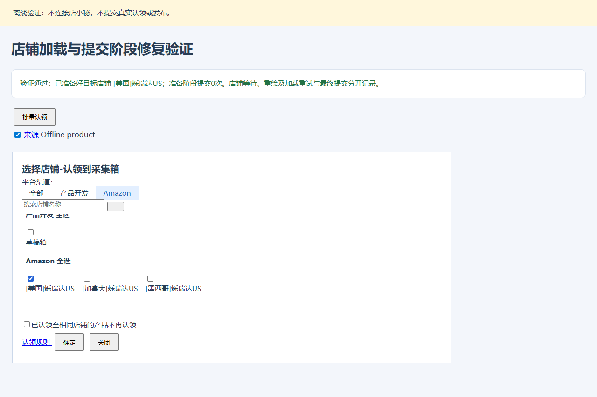

# 认领店铺加载修复

版本：v0.4.45。日期：2026-11-06，北京时间。

## 现场和原因

现场日志为11:33:11选择21条准备认领，11:33:42报“提交状态不确定，已停止：等待超时：店铺加载”。内置浏览器仍停在“选择店铺-认领到采集箱”，[美国]烁瑞达US、加拿大及墨西哥店铺已显示，已选0个，没有点击确定，也没有进入认领进度。

旧代码缓存第一次找到的弹窗节点，随后只对该节点等待20秒。店铺列表延迟或整个弹窗节点被替换时，等待可能一直读取旧节点。店铺使用render-container/render-skeleton按视口加载，旧逻辑也没有主动滚动该区域。更重要的是，整个准备过程都被标记为风险提交，导致还没点击确定就被记录成认领提交不确定。

本次现场仅作只读检查；没有替用户点击认领确定、重新采集、移入、填写或发布真实商品。

## 修复行为

1. prepareClaim只准备选择；claim在prepared模式下再次核对产品ID、目标店铺及站点，再点击一次确定。准备阶段不建立提交风险锁。
2. 每轮重新查找当前弹窗；已有同批次弹窗可复用。选择Amazon渠道，清空残留店铺搜索，滚动到目标平台及可见占位块。等待目标准确匹配，每次最多90秒。
3. 加载超时、连接变化或提交前重绘丢值可自动重新打开准备，最多3次。缺少目标、多个同名目标、禁用等明确问题不盲目重复，记录“尚未提交”，其他可执行店铺继续。
4. 提交前同时确认勾选的采集ID完全一致、只有目标店铺被勾选。选择变化时不点击确定，可再次准备。点击后仅等待进度，不自动再次点击。
5. 后台保存preparing/prepared/submitting/submitted阶段。已提交后的错误仍保留锁，后续进度读取错误即使误带notSubmitted标记也不能触发重提。
6. 每页认领完成后立即保存claimedCollectorIds。后页准备失败时保留前页认领结果，继续时只认领剩余ID；整条完成后从只读产品映射保存点恢复。
7. 旧任务仅在intent为claim、阶段为认领、没有其他待确认移入或新版提交保存点、错误准确等于“等待超时：店铺加载”时解除误锁。这个错误在旧代码中发生于确定按钮之前；若前页记录已有认领成功完成日志，则改为只读恢复映射，避免重新认领前页。认领进度超时、其他提交错误和发布结果保护不放行。

## 验证

- 全部177项Node测试通过，覆盖准备失败自动恢复、仅准备动作无风险标记、明确缺店铺、提交前变化、提交后断线、后台阶段保存与旧误锁迁移、前页认领保存点和用户停止。
- `node tests/claim-preparation-browser.cjs`离线重放真实认领弹窗结构，使用与现场一致的3个站点控件，覆盖超过旧20秒的延迟、整窗替换、按滚动显示店铺、隐藏占位块、复用现有弹窗、缺失/重复/禁用目标、提交前丢值、停止和点击后超时。准备始终点击确定0次，成功提交只点击1次。
- 原有采集重试及21条异常隔离继续执行离线浏览器回归。
- 扩展语法、引用与ZIP完整性检查通过，包中只含运行所需扩展文件。

更新时用新版文件覆盖原插件加载目录，然后在扩展管理点击重新加载，刷新页面，再点击继续执行。保留当前缓存、上传表格和扩展安装位置，以保留原批次保存点。
