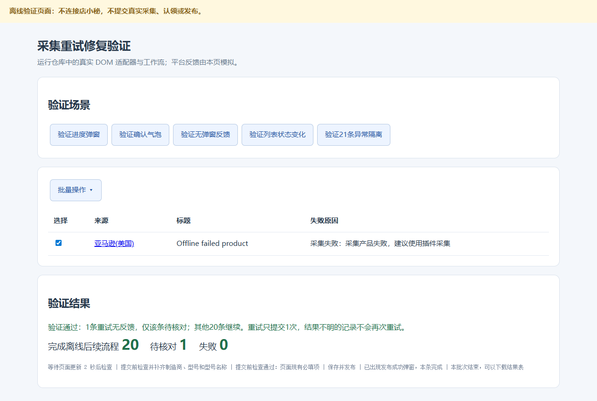

# 采集失败重试修复与验证

版本：v0.4.43。日期：2026-11-05，北京时间。

## 问题与原因

用户截图显示整组21条采集结束时成功20、失败1；随后对1条提交批量重试，出现“等待超时：重试提示”，面板显示失败21。

旧适配器点击批量重试后，只等待`.ant-modal`，无法识别确认气泡、直接入队提示或列表变化。超时只能说明没有识别到预期反馈，不能据此认定平台没有提交。旧工作流将重试的不确定性升级为整批待人工核对；面板又把待核对加入失败数，导致21条全显示为失败。

本次现场已变为全部42条、已认领21条、采集失败21条；失败列表实际全为“跳过采集 / 采集已经采集过”。核对了批量重试菜单，没有点击真实重试或确认重采，没有新建、认领、保存或发布真实商品。当前页面无法复现原来的真实失败反馈，因此不能断言当时平台究竟返回哪种反馈。

## 修复后的行为

1. 等整组首次采集最终完成，再查未认领，未找到的来源继续查已认领。已成功找到的记录先保存采集ID、标题及保存点。
2. 有真实失败时，只选择本批次未找到成功结果的来源；排除“跳过采集 / 采集已经采集过”和历史记录。数量与本次失败数不一致时只保留未确认来源待核对，已成功记录继续。
3. 每页重试前保存`retry_review`核对点，记录实际提交的ID。兼容Ant Modal、Ant Popover/Popconfirm及Element确认框；确定按钮每个节点只点击一次。也可识别进度弹窗、新的提交提示或稳定的列表移出。
4. 反馈仅表示可能已提交。随后按来源核对未认领、已认领、采集中及真实失败记录。成功记录立即保存；进度确认、采集中返回失败、失败文本更新等证据才可确认重试失败。没有明确状态变化的记录转待核对，不重复提交。
5. 一条或一页重试异常只影响对应尚未确认的记录。其他采集成功记录继续认领及后续步骤。面板单独显示“待核对”和“失败”。
6. 旧版全局重试锁按实际重试记录迁移。继续执行时先只读核对已有结果：找到则继续后续步骤，未找到则继续待核对，不重新采集或重试。发布结果不明等其他提交保护保持原规则。

## 验证

- 全部160项Node测试通过，覆盖等待整组完成、单条隔离、明确拒绝、重试仍失败、无变化超时、失败计数不一致、部分失败计数、旧锁迁移、提交后停止及只读恢复。
- `node tests/retry-browser.cjs`在独立无头Chromium运行真实DOM适配器与工作流，平台部分使用离线模拟。覆盖进度弹窗、两种确认气泡、直接入队、列表变化、拒绝反馈和跳过重采保护。
- 离线21条场景模拟20条成功和1条重试无反馈，结果为20条完成后续流程、1条待核对、0条失败，重试仅提交一次。
- 右侧内置浏览器已核对当前列表及批量重试菜单。本地验证页在内置浏览器访问超时，未将独立浏览器的离线验证描述为真实平台重试成功。
- `node tests/verify-package.cjs`和`python tests/package-release.py`检查脚本引用、语法、版本、ZIP根目录清单及压缩包完整性；扩展包不含工作簿、验证页面或测试脚本。

离线结果截图：

重新加载v0.4.43扩展并刷新采集页后生效。原批次点击继续执行时会先核对已有采集记录。
